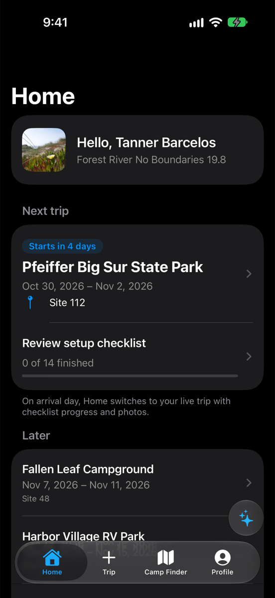

# RoamReady

  

RoamReady is a native app for iPhone, iPad, and Mac for planning camping trips and keeping rig details, setup and teardown checklists, booking information, documents, and trip memories together.

Its core workflows work offline, with no account required. Camp Finder helps you explore campgrounds and RV parks through Apple Maps when connected.

## Features

- Keep your rig details, including its VIN and license plate, and reusable camping checklists with Reminders-style priorities and notes in one place.
- Organize trips, reservation details, and campground site notes.
- Store manuals and paperwork for offline access.
- Save trip photos, captions, and return-or-avoid ratings.
- Find campgrounds, check weather, and get camping guidance.

## Getting started

1. Open `RoamReady.xcodeproj` on a Mac with Xcode 27.1 or later and the iOS 27.1 SDK.
2. Select the **RoamReady** scheme and an iOS 27 simulator, or **My Mac (Mac Catalyst)**.
3. Build and run.

RoamReady is a development build targeting iOS 27.0 on iPhone and iPad, and macOS 27 through Mac Catalyst. Live weather and iCloud sync require Apple capability configuration; physical-device acceptance remains outstanding. See [build and validation](docs/validation.md) for setup and checks.

## Documentation

Start with the [documentation index](docs/README.md) for the user guide, feature reference, design, architecture, development instructions, and release plans.

## License

[MIT](LICENSE). The vendored [sqlite-vec](Sources/CSQLiteVec/PROVENANCE.md) C source (MIT/Apache-2.0) is the one third-party code in the app. sqlite-vec is Copyright (c) 2024 Alex Garcia, dual-licensed MIT and Apache-2.0 (texts in `Sources/CSQLiteVec/LICENSE-MIT` and `LICENSE-APACHE`); RoamReady uses it under MIT. The app has no acknowledgements screen yet, so this notice and the privacy policy are where it is disclosed. See [data sources and coverage](docs/campground-data.md) for third-party data attribution and reuse limits.
