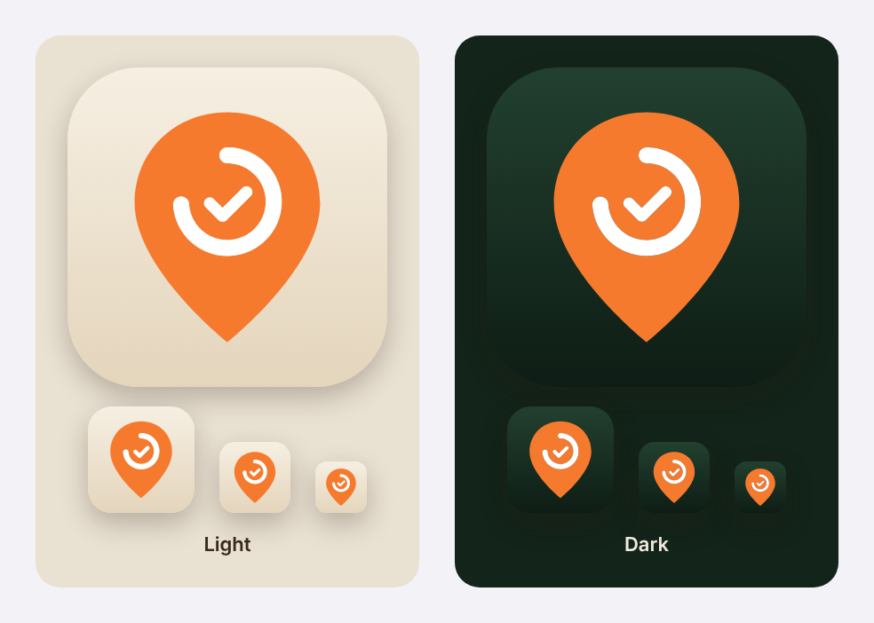

# Interface design

[Documentation index](README.md) · [Architecture](architecture.md)

## System-first direction

RoamReady follows the approved **A · System-first** design. The interface uses native SwiftUI lists, forms, navigation stacks, and tab controls, with semantic colors and a default System appearance with device-local Light/Dark overrides in Profile. Standard navigation and tabs receive the operating system's Liquid Glass styling at the app's iOS 27 deployment target.

The [approved visual reference](design-A.png) records the design direction. Current behavior and labels are defined by the SwiftUI source; the image is not a complete feature specification.

## Navigation and information hierarchy

The root view shows onboarding when there is no profile, then five tabs (Trip opens the new-trip sheet). iPhone shows at most five tabs, so on supported AI devices Assistant opens as a sheet from an **Ask Assistant** bar above the tab bar (`tabViewBottomAccessory`), visible on every tab:

| Tab | Primary responsibility |
| --- | --- |
| Home | The current trip during its arrival/departure dates, checklist progress, memories, quick trip creation, and local temperature. Before arrival day it shows the next trip's countdown and setup checklist. |
| Plan | Upcoming/past trips and their booking, checklist, weather, and memory details. |
| Camp Finder | Online campground/RV park map and search, place details, and saved lists. |
| Assistant (toolbar sheet) | General camping troubleshooting and follow-up chat, without requiring a trip. Hidden on non-AI devices. |
| Profile | Rig/profile settings, default lists, documents, storage/sync, and library management. |

Trip details keep booking information together and link to setup/teardown, **Photos & site notes**, documents, and camping help. Forms group campground, rig, dates, optional site details, booking, timing, and cost so users can save a minimal trip before adding paperwork.

## Interaction rules

- Use standard list/form controls and system sheets for editing, document preview, camera/photo import, and sharing.
- Edit drafts in forms so **Cancel** discards edits before save.
- Keep checklist progress visible and make complete, skip, reorder, and customization actions available near the relevant steps.
- Keep optional booking/site fields optional; show length warnings near site details.
- Explain permanent deletion before confirming it, including what is deleted and what is kept.
- Distinguish a local save from cloud delivery and show save failures with retry.
- Explain network and AI unavailability at the affected feature, while local workflows remain available.
- Show forecast retrieval times and explain Apple Maps coverage and missing place details so users can judge the data.

- Empty states use `ContentUnavailableView` with a tinted SF Symbol, copy that names what the screen will hold, and buttons for the next step (add a trip, open Camp Finder). They never point at the tab bar.

These patterns support the core use case: opening a saved trip at a campground with limited connectivity.

## Privacy and permissions in the interface

Onboarding asks for rig details without sign-up. Home weather and Camp Finder's Near me request location only when invoked, with approximate location supported. Text search and manual trip entry do not require location permission. PhotosPicker provides access to selected items; camera capture uses the system permission prompt. Document categories determine protection, so the user explicitly chooses one before saving.

Sync is configured through the onboarding/Profile toggle, which works offline and explicitly shows that changes apply on the next app launch. Export copy explains that documents leave iCloud protection as readable originals. Full-library erase and trip deletion have separate confirmation flows. See the [identity contract](account-and-offline-contract.md) and [document vault](document-vault.md).

## Accessibility and adaptive layout

The app targets iPhone and iPad in portrait and landscape, and Mac through Mac Catalyst, and defaults to system appearance, with explicit Light/Dark choices applied at the window root. Native controls provide the starting point for Dynamic Type, VoiceOver, and platform interaction conventions.

Release acceptance must still verify large text, VoiceOver labels and order, reduced motion/transparency, light/dark contrast, rotation, iPad split view, long campground names, and outdoor readability. Treat these as validation requirements, not completed accessibility certification. The [validation guide](validation.md#airplane-mode-acceptance-pass) includes the device checklist.

## First-rig onboarding

Three native form screens introduce the setup, collect rig details, and personalize the library. The welcome uses an SF Symbols campsite illustration and full-width rig choices with explicit selection indicators. A persistent bottom action and labeled step progress keep the next action visible. Each stage opens at the top; transitions respect Reduce Motion. Semantic colors, system typography, and standard navigation/materials follow the system appearance.

Required RV details stay enforced; tent and car camping can continue without them. The last screen previews the saved rig and prepared checklists. Name, documents, and configured iCloud preferences remain optional; documents and sync follow rig creation so the first choice stays focused. No permission prompts or account are required to begin. Rig and profile writes must succeed before advancing; failed profile insertion is removed so setup can be retried.

Before release, check all eight rig types, back navigation without losing draft details, interrupted setup/relaunch, save failures, optional document/photo import, keyboard dismissal, large text, VoiceOver selection/progress, reduced motion/transparency, landscape/iPad, and light/dark appearance on an iOS 27 device or simulator. The illustrated flow has not been visually verified in the Linux workspace.

## App icon

The icon is a blaze-orange map pin holding a three-quarter progress ring and a check: finding a campsite and getting it set up. The light appearance uses a sand background and the dark appearance uses a forest-green background. Neither depends on the rig type.

`Camp/AppIcon.icon` is an Icon Composer bundle, so iOS applies Liquid Glass and derives the Clear and Tinted appearances from its layers. The `Pin` group contains the pin, with the ring and check cut out of it. The `Progress` group contains the white ring and check, which fill those cut-outs. Because the layers never overlap, stacking order does not affect the result. The target selects the bundle through `ASSETCATALOG_COMPILER_APPICON_NAME = AppIcon`.

The bundle was written by hand rather than exported from Icon Composer. Open it in Icon Composer on a Mac to check its glass, shadow, and translucency settings in each appearance. Use the Home Screen, Spotlight, and Settings sizes to judge it, and check Clear and Tinted on a device. The preview image above approximates the flat artwork; it does not show Liquid Glass.
