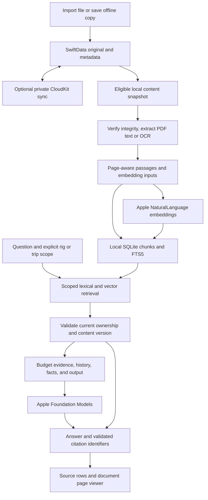

# V1 completion and document assistant build plan

Status: product scope settled and ready for implementation, October 27, 2026. Repository baseline: `7c99419fe9d6fb904b4c779faf2df6bdaf53613b`. Engineering choices remain subject to the explicit validation gates below. This document describes future work, not shipped behavior, and supersedes the earlier document-RAG handoff where details differ.

## What is actually on main

`git pull --ff-only origin main` reported already up to date, with a clean checkout before these planning documents. PR #76 (v1 audit) and #81 (manual-only UI runs) are merged. No open PRs were returned during this review.

- The latest [Mac run](https://github.com/TannerBarcelos/RoamReady/actions/runs/40597853219) passed package tests and Debug/Release Catalyst builds. The latest [iOS/iPad run](https://github.com/TannerBarcelos/RoamReady/actions/runs/40597853127) passed build/configuration checks.
- These latest regular CI runs do **not** execute UI tests. The new manual UI workflow has no runs yet. The merged audit's outstanding iPad Dynamic Type finding remains unresolved; green build CI does not clear it.
- Existing onboarding, trips, rigs, checklist defaults, documents, photos, weather, Camp Finder, local storage, and optional CloudKit integration are implemented. The audit records specific physical-device/service checks still unexecuted.
- Assistant currently uses Foundation Models with bounded rig facts, checklist excerpts, three recent turns, and one smaller-prompt retry. It does **not** ingest uploaded document text into its prompts. There is no document extraction, embedding, vector store, retrieval, document citation UI, or RAG eval suite yet.
- General chat is scoped to the active rig. Trip help uses that trip's rig and checklist copies. It does not yet provide the full trip record as assistant context.
- Global conversation survives closing the sheet, clears on app quit, and is not persisted. Trip/checklist chats start separately. Those remain the accepted v1 rules.

Evidence: `docs/v1-audit.md`, `Sources/CampCore/CampingHelpRequest.swift`, `CampingGeneration.swift`, `Camp/Features/Assistant/{AssistantView,CampingAssistant,AppleCampingResponseGenerator}.swift`, and `.github/workflows/`.

## Release scope and tracker reconciliation

The owner already confirmed iPhone, iPad, and Mac in v1; Apple-only on-device generation; hidden AI entry on unsupported devices; and $4.99 one-time pricing. Do not reopen those decisions. This conversation adds document retrieval, source presentation, loading/readiness UI, and evals to the requested v1 build.

| Work | Current evidence | Required action |
| --- | --- | --- |
| iPad accessibility | Last audit reports one unresolved Dynamic Type finding in the scrolled rig section; exact node unidentified | Reproduce, identify the node, fix the actual control/layout, and rerun the full focused audit without suppressing findings. |
| Document assistant | No implementation on main | Build the slices below, including evaluation and source navigation. |
| Release documentation | #6/#74 still describe superseded tabs, undecided platforms, old encryption behavior, and merged fixes | Reconcile tracker content with current code and the settled scope; retain unchecked hardware/service gates. Architecture's stale CI description was corrected in this planning pass. |
| Saved chats and compaction (#65) | Explicitly deferred by the owner during the merged audit | Keep deferred. Preserve bounded history and overflow retry. Implement the narrower explicit trip scope below without reinstating all of #65. |
| Device acceptance | Not established by CI | Run signed iPhone/iPad/Mac, CloudKit, WeatherKit, real-model, media, performance, and accessibility checks; turn observed defects into bounded code fixes. |
| Distribution | Provisioning, production schema, TestFlight/listing checks outstanding | Owner/account steps and release evidence; not missing application features. |

Open issues #20/#29/#34 are post-v1 work. There is no evidence that remote models, offline maps, a rig catalog, saved sessions, or a backend need implementation to finish the agreed v1. This review is source/tracker reconciliation, not a new full runtime certification. No new local tests or UI runs were executed for this planning pass.

## Settled AI direction

- SwiftData and its optional private CloudKit mirroring remain the source of truth for original documents and ownership metadata.
- Use a separate, disposable local SQLite search database with FTS5 plus statically linked, pinned `sqlite-vec`. Never open SwiftData's private database with raw SQL. Update the current no-external-dependencies documentation to describe this deliberately introduced C dependency, including its license and provenance.
- Apple NaturalLanguage English sentence embeddings are the v1 vector provider. No third-party embedding model download or remote inference service. Read language, revision, and dimension at runtime; do not assume 512 dimensions universally.
- Sync originals and the document's inclusion preference through existing library mirroring. Each device builds its own index after verified bytes become available. Do not sync embeddings or the index file.
- Include Manual, Service & maintenance, Warranty, and Reservation. Exclude Registration and Insurance. Other requires explicit opt-in and defaults off.
- A link is searchable only after its content has been explicitly saved locally. Chat must not fetch URLs encountered in documents.
- Keep bounded rig context and existing assistant availability/safety behavior. Treat extracted passages as untrusted reference data.
- **Confirmed scope:** General Assistant searches eligible documents belonging to the active rig. Trip/checklist Assistant searches eligible documents belonging to the explicitly opened trip and that trip's rig, including an archived rig when applicable. Show the scope in chat; do not automatically include the current/next trip in general chat.
- **Confirmed unattached-document rule:** Exclude unattached documents from Assistant search until assigned to a rig or trip. Add “Assign to rig or trip” in document details. Assignment does not override category exclusions, Other opt-in, or local-content requirements.
- **Confirmed conflict rule:** Surface conflicting saved facts and document passages, identify each source, and let the user resolve the discrepancy. Apply the same rule to conflicting documents. Do not silently choose a winner or modify saved trip data.
- **Confirmed indexing/readiness rule:** Chat uses references already ready without waiting for every document to finish indexing. Clearly identify incomplete coverage within the current scope. If a question depends on an unfinished or unavailable document, explain that limitation rather than guess, and offer retry when it becomes ready.
- **Confirmed language rule:** V1 document Q&A is English-only. Non-English documents remain available for normal viewing/sharing but are not used as AI evidence. No non-English lexical fallback, automatic translation, or cross-language document answers. FTS-only fallback for eligible English text still applies when embeddings are unavailable.
- Show document sources and improve loading states. Include retrieval and answer-quality evals plus an explanatory guide and walkthrough.

Earlier temporary experiments verified a 512-element host Apple embedding, iOS API type-checking, and `sqlite-vec` v0.1.9 static registration/insert/KNN on an iOS simulator. Those experiments were removed. They do not prove production FTS5 integration, physical-device performance, Catalyst indexing, document extraction quality, or the full pipeline. Reproduce relevant checks in maintained tests.

## Resolved product decisions

The owner resolved these decisions during the design interview. Do not reopen them unless implementation reveals a concrete incompatibility.

1. **Settled — reservation/trip scope:** Owner accepted explicit scope. General Assistant uses the active rig's eligible documents; trip/checklist Assistant uses the opened trip's eligible documents plus its rig's eligible documents. Show the scope. Do not infer the current/next booking for general chat. Additional global trip grounding remains deferred.
2. **Settled — unattached documents:** Owner accepted excluding them from Assistant search until assigned to a rig or trip, with an “Assign to rig or trip” action in document details. The current editor has no ownership reassignment control; implement this UI/model operation. A confirmation retained after deleting a trip must not enter another trip's answers automatically. This replaces the earlier handoff's ambiguous “relevant unattached documents” allowance.
3. **Settled — disagreement:** Owner confirmed that conflicting sources must be surfaced. Show both the saved trip fact and conflicting reservation passage with their origins, or both conflicting document passages with citations. Explain the discrepancy and leave resolution to the user; never silently pick a winner or edit saved trip data. A newer filename, import date, or higher retrieval score alone does not establish which fact is authoritative.
4. **Settled — waiting and failure UX:** Owner accepted immediate use of ready references with visible incomplete coverage and retry after indexing. Do not hold a chat request for an entire manual to be OCR'd. If the question specifically requires an unfinished or unavailable reservation/manual, explain that it cannot yet support the answer. Keep general questions usable. Readiness updates must not silently regenerate or replace an existing answer.
5. **Settled — language:** Owner explicitly chose English only, replacing the proposed limited non-English keyword fallback. English queries and English document evidence define v1 document Q&A. Explain unsupported language clearly without blocking normal document storage or preview. This decision concerns the new document-Q&A feature; it does not change the app's existing general-chat locale availability policy.

The source list/citation mechanics, chunk sizing, SQL scope filtering, and model limits are engineering validation tasks; they should not become unnecessary owner questions.

Before calling the feature release-ready, establish measured retrieval/latency baselines on supported hardware and record numeric quality/performance gates. Those results are implementation deliverables, not facts established by this design review.

## Architecture and data flow

### Service boundaries

Use a small `DocumentSearch` local package/module for deterministic eligibility, chunking, retrieval fusion, index schema, and SQLite integration, subject to actual package/platform linking validation. Keep PDFKit/Vision/NaturalLanguage adapters in the app when that best fits Apple platform tests. CampPersistence supplies immutable document snapshots, not model instances shared across actors. CampCore owns the bounded request/evidence structures.

`LibraryController` owns index lifecycle and a serial indexing coordinator. Capture metadata/content on the model context actor; verify, extract, OCR, and operate on SQLite away from the UI actor. Own a reusable Apple embedding instance within one serialized embedding service. Load lazily, report unavailable/nil results, and fall back to lexical retrieval. Apple supplies the embedding assets; initial fresh-device/offline availability must be measured, not promised. Foundation Models readiness and embedding readiness are independent.

Use a protected Application Support directory excluded from backup for the rebuildable index. Cover the database, WAL/SHM companions, extraction staging, and temporary previews. Do not log reservation text, vectors, or user questions. Ensure cancellation and awaited shutdown prevent index writers from recreating files after erase. A corrupted index can be rebuilt without changing originals.

### Ingestion and index lifecycle

1. Discover eligible document IDs, ownership, category, opt-in, and checksums after import/save-copy and during bounded startup/foreground reconciliation. Follow existing CloudKit behavior; metadata arriving first is a waiting state, not an indexing failure.
2. Capture one verified content snapshot at a time, respecting the current 50 MiB cap. Avoid materializing every document's `Data` to build a list or readiness indicator. PDF byte size alone does not bound decoded image memory: cap rendered page dimensions and OCR work.
3. Extract text from PDFKit pages; OCR scanned/image pages using Vision. Retain one-based PDF page ordinals, optional printed page labels, section text, source ranges, and extraction provenance. Mixed PDFs, rotated scans, tables, and empty/encrypted PDFs need explicit outcomes. Low-quality OCR must not be presented as exact specifications.

   Restrict document Q&A evidence to English. Detect language from substantive text, not filenames, isolated part numbers, or short codes. For multilingual documents, admit only confidently identified English passages and mark coverage as partial; unsupported/undetermined prose must not silently enter retrieval. Show a clear English-only status where no eligible English text exists. Preserve codes, brand names, and numbers inside English passages. Validate the language policy with fixtures rather than assuming language detection is perfect.
4. Maintain human-readable evidence passages independently from bounded embedding inputs. Measure Apple sentence embedding behavior on short/long passages. Do not assume a paragraph API or silently truncate manuals to the embedding's first sentence. Pick sentence aggregation or smaller sentence groups from eval evidence; version that choice.
5. Store document manifest, text passages, FTS rows, vector rows, and version metadata. Include original checksum, extraction/chunking version, language, embedding revision/dimension, and scope metadata. Distinguish lexical-ready from vector-ready.
6. Build staging rows and publish a document generation atomically. On replacement, never serve the old checksum as current evidence while the replacement is indexing. Cancellation/crash may keep an old complete generation on disk, but the live-version check must exclude it.
7. Reconcile edits, deletion, opt-out, moved ownership, late bytes, model revisions, and app restarts. Keep lexical search usable during vector rebuilding. Clear incompatible vectors from retrieval immediately.
8. Serialize/bound work, checkpoint progress between pages, yield for interactive requests, and avoid duplicate jobs. App-owned indexing can continue while foregrounded after the sheet closes; dismissing chat cancels that request. Do not promise guaranteed iOS background completion.

For document assignment, provide a native rig/trip picker and save the chosen relationship through CampPersistence. Assigning to a trip clears direct rig ownership; retrieval derives the rig from the trip. Assigning to a rig clears trip ownership. Preserve original bytes and checksum, handle save failures, and refresh eligibility/scope after saving or receiving mirrored changes. Unattached documents remain previewable/shareable but are excluded from retrieval even if stale index rows exist. Assignment queues indexing when otherwise eligible; it does not bypass category or opt-in rules.

### Retrieval and generation

- Resolve scope before search; use explicit ID allow-lists/partitions compatible with the chosen SQLite adapter. A global top-K followed only by scope filtering can miss all relevant local passages; prove scoped candidate retrieval with adversarial fixtures.
- Snapshot rig/trip identity for each request. On a scope change, cancel in-flight work and prevent prior-scope conversation text from entering the new prompt. Likewise, do not reuse prior document-derived claims as evidence after the underlying document is deleted, reassigned, replaced, or excluded. Re-retrieve current evidence for follow-ups.
- For non-English document questions, explain the English-only limit and ask for an English question; do not silently translate or retrieve non-English evidence. Do not reject short exact-code queries solely because a language recognizer cannot classify them.
- Use the current question plus bounded prior **user** context for follow-ups. Do not turn a prior generated claim into source evidence. Keep fault codes, numbers, units, and reservation identifiers in lexical queries; parameterize SQL and safely form FTS expressions.
- Fuse lexical and vector ranks, deduplicate passages, preserve useful adjacent procedural context, and impose one total prompt budget. Rank fusion alone is not a relevance threshold: unrelated top-K results still require a no-evidence decision calibrated with negative eval cases.
- Validate live document IDs, checksums, inclusion, and scope immediately before constructing evidence. Persisted foreign keys in a disposable index do not prove a document is still available or allowed.
- Budget system instructions, rig/trip facts, history, checklist context, document evidence, and output together. Preserve the existing 512-token output target initially. Avoid claiming that character counts are tokens; validate limits against the actual Foundation Models runtime.
- The compact retry needs its **own** evidence manifest. If a retry drops passages, the answer must not cite the dropped passages. Keep the strongest current evidence and question before old conversation when shrinking the request.
- Keep source facts separate from general camping advice. Missing reservation dates, access codes, manufacturer specifications, or procedures cannot be supplied from general knowledge.
- Supply bounded saved trip facts in trip/checklist chat so answers can identify disagreements with retrieved reservation evidence. Keep their provenance distinct from document facts. When the available evidence conflicts about the same booking/subject, explicitly present the alternatives and their sources. Do not claim all documents were checked when retrieval only supplied selected passages; use targeted follow-up retrieval when an apparent conflict requires neighboring context.

### Sources and UI

Each supplied passage receives a request-local source ID mapped to document UUID, checksum, title, category, page/range, and section. Request structured cited IDs when the supported Foundation Models interface permits; otherwise validate a small citation-marker format. Reject unknown or omitted-from-retry IDs. A valid ID establishes provenance, not factual support: answer evals must check entailment.

Label model-cited, validated references as sources; distinguish uncited retrieved material as references searched/consulted if displayed. Do not label every top-K result “used” automatically. Explain missing citations rather than inventing support. Preserve bundled checklist attribution separately.

Source taps resolve the document's current availability and version. A replaced/deleted source needs a clear changed/unavailable state; do not silently open a new file at the old citation. Use a PDFKit viewer for reliable page navigation if Quick Look cannot offer it; retain existing preview/share for ordinary documents and images. Verify on iPhone, iPad, and Catalyst.

Expose real stages: searching references, preparing request, generating answer, failure/retry. Track indexing independently with queued/extracting/indexing, ready, waiting for download, no usable text, unsupported, and retryable failure states. Show only stages that happened, avoid artificial percentages, announce meaningful changes accessibly, and guard UI updates with request identity so canceled work cannot overwrite a new request.

Capture scoped document readiness with each request so its answer can accurately describe which references were available. Keep a separate live readiness indicator as indexing progresses. Once a relevant document finishes, make retry available while preserving the original answer; do not automatically submit a new question. Distinguish documents still processing from failed extraction or missing cloud bytes so the suggested next action is accurate.

## Build order and completion evidence

| Slice | Concrete deliverable | Completion evidence |
| --- | --- | --- |
| 1. Close existing accessibility defect | Reproduction and minimal fix in Profile/rig layout or actual offending control | Full focused iPad audit passes, findings retained if not fixed; iPhone regression pass. Preserve manual-only UI workflow. |
| 2. Prove maintained search foundation | Narrow SQLite/C adapter, pinned license/source, schema, embedding adapter, version lifecycle | File-backed FTS/vector insert/query/reopen/delete on simulator and Catalyst; unavailable-embedding and model-change cases. |
| 3. One end-to-end manual | Import a small text PDF → index → ask → answer → cited page | A real visible vertical slice with bounded prompt and persisted/reopened local index; first retrieval eval cases included. |
| 4. Complete ingestion and scope | OCR, reservations, opt-in, document assignment, scoped queries, reconciliation, deletion/erase | Integration cases for mixed scans, exact codes, delayed bytes, updates, stale indexes, two rigs/trips, interrupted jobs, and deleting a trip then explicitly reassigning its retained document. |
| 5. Finish chat and source experience | Actual loading stages, index readiness, cancellation/retry, robust page viewer | Deterministic UI coverage plus manual accessibility/layout on all three platforms; no-source/general-answer behavior. |
| 6. Establish quality and performance baseline | Full small eval corpus, reports, benchmarks, guide, owner walkthrough | Per-case retrieval/answer evidence; measured baseline; critical isolation/deletion/false-source failures resolved. |
| 7. Release reconciliation | Update current behavior docs, issue checklist, privacy/dependency notices, schema notes | Every codeable item has evidence or a specific remaining defect; separate signed-device/provisioning gates remain explicit. |

Slices 2–6 are one feature and should not be called complete at scaffolding or API validation. Add test coverage as each slice becomes executable. Complete schema-affecting opt-in metadata before final CloudKit Production deployment, unless an already deployed schema requires an additive rollout. Verify deployment state rather than assume it.

## Evals and learning deliverables

Create a versioned synthetic/licensed corpus with roughly 20–30 initial questions and machine-readable expected evidence. Include paraphrases, exact fault codes, reservation dates, two rigs/trips, moved/deleted/opted-out documents, unavailable bytes, conflicting records, unanswerable questions, injected document instructions, OCR noise, and compact retries. Keep private manuals/reservations out of Git and CI artifacts.

Label relevance by stable document version and page/span or required evidence groups, not only generated chunk IDs that change when chunking changes. Separately retain a development subset for tuning and a small held-out regression subset; document updates to both.

- **Hit@5:** whether at least one relevant passage appears in the first five. This was incorrectly called Recall@5 in the earlier temporary handoff.
- **Recall@5:** proportion of labeled relevant evidence retrieved in the first five. Explain the denominator and avoid double-counting overlapping chunks covering the same evidence span.
- **MRR:** reciprocal rank of the first relevant result, averaged across answerable cases. Treat unanswerable cases separately; do not divide by an empty relevance set.
- Also report exact-code success, scope/exclusion violations, stale evidence, no-evidence false positives, citation validity, and per-case misses. Aggregate scores cannot hide a reservation from the wrong trip.

Use deterministic fake embeddings for plumbing tests; actual Apple embeddings for retrieval-quality baselines; human review rubrics for generated answers. Rubric: supported facts, correct evidence attribution, no invented specifications/booking details, appropriate missing-evidence response, and preservation of safety guidance. Deterministic checks cannot prove semantic grounding. Optional model judges must not be the sole oracle.

Conflict evals must include saved check-in at 2 p.m. versus a confirmation at 3 p.m., two confirmations with different times, and a non-conflict control where times belong to different dates or time zones. Check retrieval of the relevant competing evidence, presentation of both values with correct provenance, no unsupported winner, and no mutation of saved trip facts. A missed competing passage is a retrieval failure even if the final answer accurately quotes the single passage it received.

Readiness cases must cover a ready manual alongside an unfinished scan, a question requiring the unfinished file, and the same question after that file becomes ready. Check incomplete-coverage messaging, no fabricated document facts, successful explicit retry, and no automatic replacement of the prior answer. Test download waits and extraction failures separately from active indexing.

Language cases must cover English text, clearly non-English documents and questions, bilingual pages with partial English coverage, OCR text of uncertain language, and language-neutral fault codes inside English documents. Ensure English FTS fallback remains functional while non-English evidence never bypasses the language rule through lexical search. Include a rig switch and document exclusion between follow-up turns to catch stale evidence leaking through conversation history.

Run repeated answer samples where nondeterminism matters. Record corpus, code, OS/hardware, embedding language/revision/dimension, extraction/chunking/ranker/prompt versions, and generation configuration. Compare compatible baselines; model changes require explicit review, not automatic baseline acceptance.

Record import/OCR/embedding throughput, cold/warm retrieval, time to answer, peak memory, index size, and cancellation responsiveness. Use real document sizes and a representative growing corpus on supported hardware; simulator timings are diagnostic, not device promises. Choose numeric targets after the first baseline; zero cross-scope/excluded/stale sources and zero invalid citation IDs are deterministic release requirements.

Keep ordinary CI fast: deterministic checks in package tests/builds, supported-runtime quality suites as explicit local/manual jobs, and UI tests manual per current policy. An unavailable Apple model is “not run,” never a passing quality result. Produce reviewable JSON and Markdown reports with expected/actual evidence and failure explanations.

Write `docs/assistant-evals.md` with actual runnable commands. Teach the owner using one passing case and one controlled failing case: labels → retrieved passages → metric → generated answer rubric → diagnose whether extraction, scope, retrieval, prompt, or generation failed → add a regression case → rerun. Deliberate challenge cases must be reported separately from required passing release cases.

## Remaining acceptance outside feature coding

After code/evals, retain the unexecuted checks in `docs/validation.md` and release issue #6: Apple provisioning/signing, CloudKit production schema and two-device/account/conflict/erase behavior, live WeatherKit, physical-device offline AI/model readiness, real camera/provider media, low-storage/interruption behavior, full VoiceOver/accessibility and large-library performance, signed Mac, archive/listing/privacy/pricing, and TestFlight. Capture build commit, hardware/OS, date, result, and linked defects. Do not equate “all known code items done” with “release certified.”
